<p align="center">
  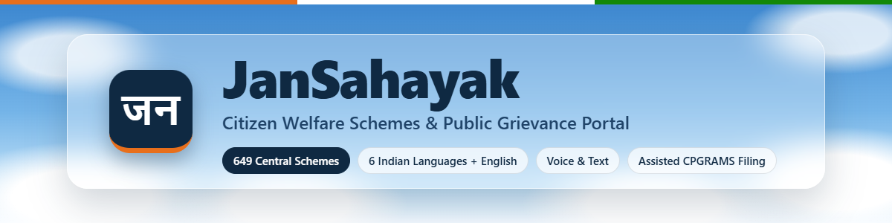
</p>

# JanSahayak AI — Multilingual Indian Citizen Welfare Copilot & Assisted CPGRAMS Grievance Agent

**IIT Kharagpur — Executive PG Certificate in Generative AI & Agentic AI (Track B Capstone Project)**

JanSahayak AI is a production-styled, voice-and-text multilingual citizen copilot built on the IIT Kharagpur Track B hosted model stack (**`Qwen/Qwen3-8B`** + **`bge-small-en-v1.5`**). It combines **Agentic Hybrid RAG (LangGraph)**, **deterministic eligibility verification**, **6-language voice I/O**, **HITL-protected CPGRAMS grievance filing with live Gmail SMTP receipts**, **Persona-based RBAC**, and **Langfuse-style observability & quantitative evaluations**.

---

## Key Capabilities

- **649 Central Government Schemes & 7,724 FAQs** across **51 Canonical Ministries** (`myScheme.gov.in`) indexed into **6,059 section-aware chunks** (`<= 440` tokens, `0 > 512`).
- **Agentic Hybrid RAG (7-Node LangGraph):** `InputGuardrail -> LanguagePivot -> Planner -> Executor -> Synthesizer -> Critic (self-healing revision loop) -> OutputLocalizer`.
- **Hybrid Search + Reranking + `.gov.in` Fallback:** Sparse `BM25Okapi` (2× title boost) + Dense `bge-small-en-v1.5` (`embeddings.npy`) → RRF (`k=60`) → Local CPU Cross-Encoder (`ms-marco-MiniLM-L-6-v2`) → DuckDuckGo `.gov.in` fallback.
- **6 Indian Languages + Voice I/O:** English, Hindi, Hinglish, Marathi, Bengali, Tamil, and Telugu with English-pivot cross-lingual consistency, Browser Web Speech STT, and zero-key server MP3 TTS (`POST /api/voice/tts` via `gTTS` + `edge-tts`).
- **HITL CPGRAMS Grievance Action + Real Email:** Formal `<= 2,000`-char drafts mapped to 51 Ministries, strict `user_confirmed=True` code gate, **real Gmail SMTP HTML confirmation receipts** (+ built-in HTML Sandbox Outbox), and **Assisted Real-Portal Handoff Packet** (`pgportal.gov.in`).
- **Safety, DPDP Privacy & Admin Observability:** Regex PII masking (Aadhaar, PAN, Phone, Bank, IFSC), Right to Erasure (`DELETE /api/sessions/{id}`), Persona Login RBAC (Admin + 4 Citizens), and Langfuse-style Span Explorer with JSON/Markdown/CSV exports.

---

## Screenshots

Every view supports light and dark mode (toggle in the header). The cloud background switches from a blue sky with white clouds in light mode to a dark blue sky with grey clouds in dark mode, and panels use frosted glass tinted to match the theme.

### Login — Light and Dark

<p align="center">
  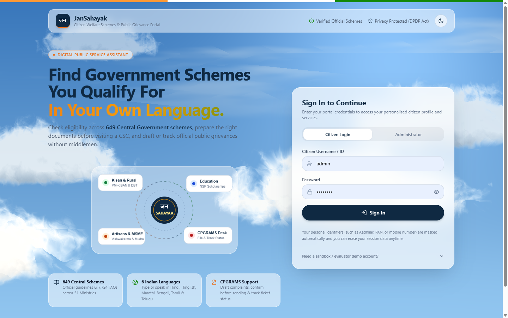
  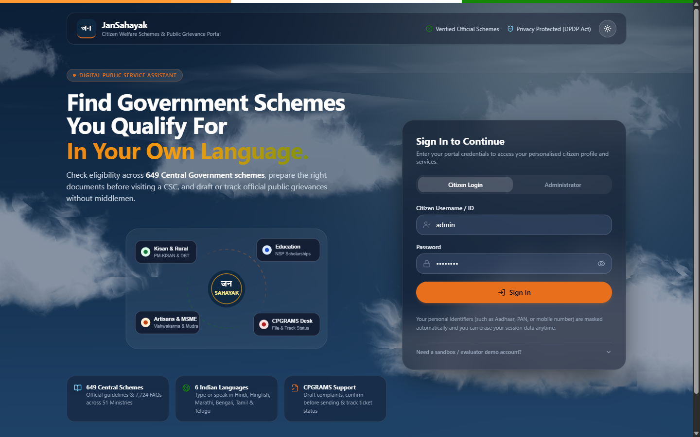
</p>

- Landing hero with the 649-scheme value proposition, trust badges, and feature cards.
- Citizen Login and Administrator tabs, plus a collapsible panel for sandbox / evaluator demo accounts.

### Citizen Helpdesk — Light and Dark

<p align="center">
  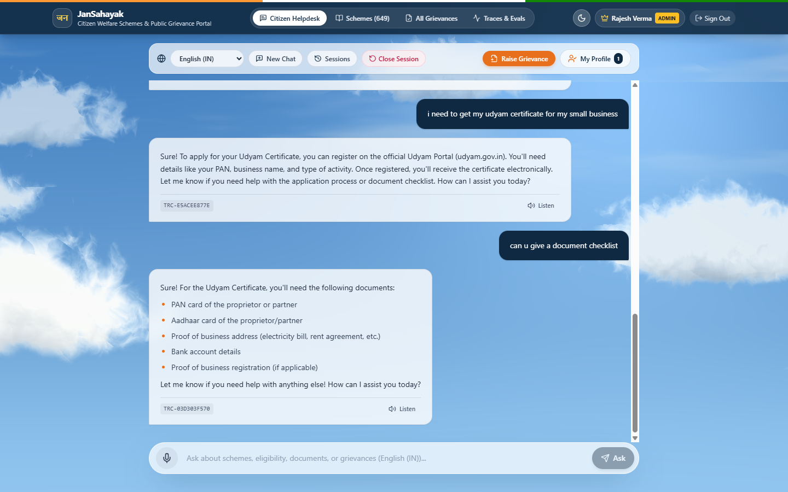
  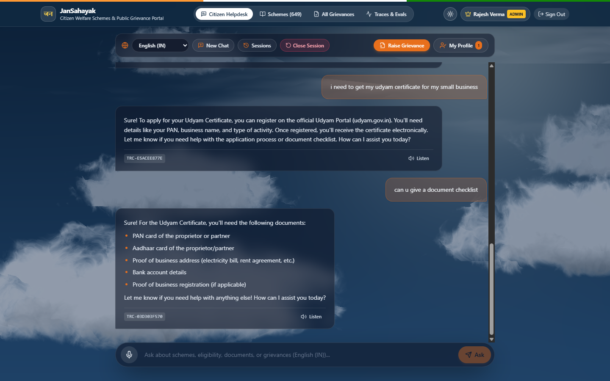
</p>

- Multilingual chat copilot with voice input, a per-answer Listen button for text-to-speech, and a language selector.
- Each answer shows a trace ID (`TRC-…`) that matches an entry in the admin Traces & Evals debugger.
- Toolbar actions: New Chat, Sessions, Close Session, Raise Grievance, and My Profile.

### Session History Sidebar

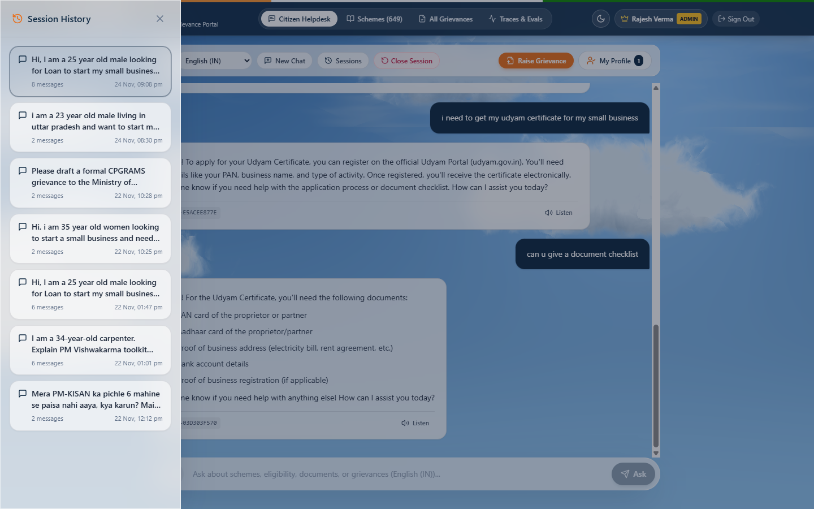

- Left-side panel listing the signed-in citizen's past conversations with message counts and timestamps.
- Selecting a conversation reopens it. The panel closes on an outside click or the Escape key.

### Citizen Profile Drawer

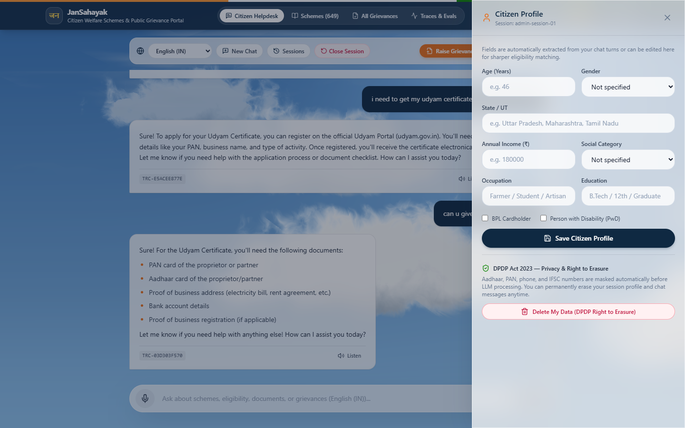

- Profile fields (age, state, income, social category, occupation, education, BPL, disability) are extracted from chat or edited by hand, which sharpens eligibility matching.
- DPDP Act 2023 notice, with a "Delete My Data" right-to-erasure action.

### Raise a Public Grievance (CPGRAMS Form)

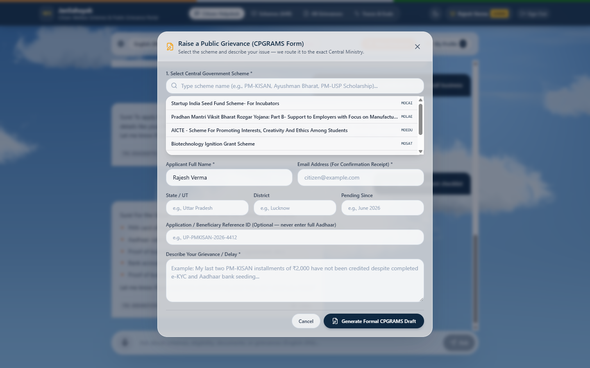

- Searchable scheme picker that routes the grievance to the correct Central Ministry.
- Applicant details, an optional reference ID (full Aadhaar numbers must not be entered), and a description of the issue.
- "Generate Formal CPGRAMS Draft" produces a draft for the citizen to confirm before anything is submitted.

### Central Government Scheme Explorer

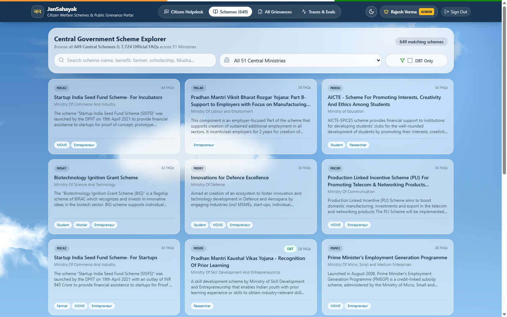

- Browse all 649 central schemes across 51 ministries, each with its FAQ count and audience tags such as MSME, Farmer, or Student.
- Search by name or keyword, filter by ministry, and toggle DBT-only schemes.

### All Grievances (CPGRAMS Sandbox Ledger)

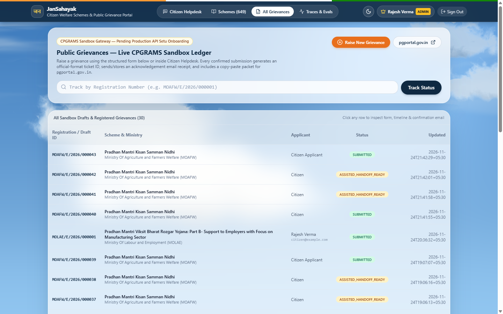

- Ledger of sandbox drafts and registered grievances with registration IDs, scheme and ministry, status, and timestamps.
- Raise a new grievance, track a status by registration number, and open the pgportal.gov.in handoff.

### Traces & Evals (Admin Only)

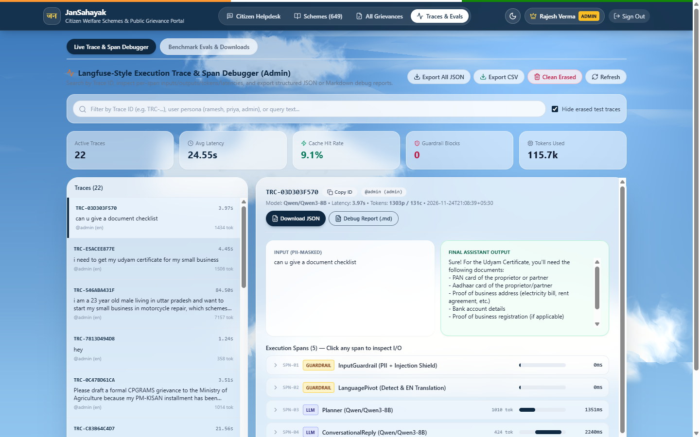

- **Live Trace & Span Debugger:** per-request view with PII-masked input, the final assistant output, and each execution span with its latency and token count. Export as JSON, CSV, or a Markdown debug report.

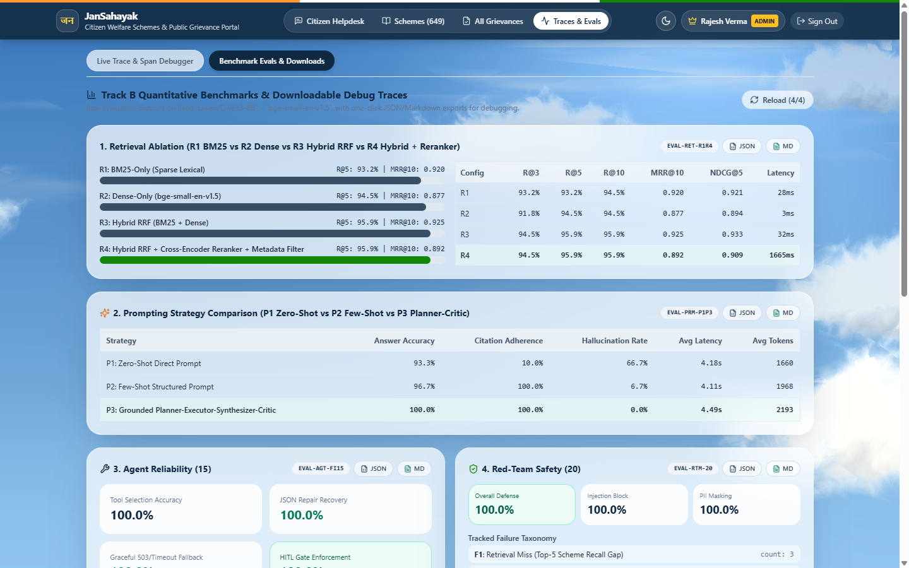

- **Benchmark Evals & Downloads:** Track B suites for retrieval ablation, prompting strategy, agent reliability, and red-team safety, each downloadable as JSON or Markdown.

---

## Verified Track B Benchmark Highlights

| Evaluation Suite | Result |
| :--- | :--- |
| **Retrieval Ablation (`R1–R4`, 73 Queries)** | Hybrid RRF (`R3`): **95.9% Recall@5**, **0.925 MRR@10**, **0.933 NDCG@5** (`31.7 ms`) • `R4` + Reranker: **95.9% Recall@5** + calibrated `[0..1]` gate |
| **Prompt Comparison (`P1–P3`, 30 Queries on `Qwen3-8B`)** | `P1` Zero-Shot: 93.3% acc / 66.7% halluc → **`P3` Planner-Critic: 100.0% accuracy, 100.0% citations, 0.0% hallucination!** |
| **Agent Fault Injection (15 Scenarios)** | **15/15 (100%)** — 5/5 JSON repair, 4/4 HITL blocks, 3/3 graceful 503/bad-JSON fallback, 3/3 tool accuracy |
| **Red-Team Adversarial Safety (20 Tests)** | Hardened from 80% → **20/20 (100%)** — 16/16 attacks blocked, 3/3 PII masked, 1/1 honest fake-scheme refusal |

---

## Complete Team Installation & Setup Guide (Windows / macOS / Linux)

> **Security Note:** `.env`, `certs/`, and `data/` (pre-built SQLite DB + 9.3 MB vector index) are intentionally excluded from Git via `.gitignore` so API keys and large binary artifacts are never leaked. Your team lead will share `JanSahayak_Private_Team_Bundle.zip` privately.

### Step 1: Prerequisites (Install Once)

Check you have these installed before starting:
1. **Git** (`git --version`)
2. **Python 3.11+** (`python --version` or `python3 --version`) — *Python 3.11 or 3.12 recommended*
3. **Node.js 20+ & npm** (`node -v` and `npm -v`) — download LTS from https://nodejs.org/

### Step 2: Clone the Private Repository

```bash
git clone https://github.com/<YOUR_USERNAME>/<YOUR_PRIVATE_REPO>.git
cd <YOUR_PRIVATE_REPO>
```

### Step 3: Add Private Secrets & Pre-Built Database

Choose **Option A (Recommended — 2 Minutes)** if your team lead sent you `JanSahayak_Private_Team_Bundle.zip`, or **Option B** to build the index from scratch:

#### Option A — Fast Setup Using Private Team Bundle (Recommended)
1. Download `JanSahayak_Private_Team_Bundle.zip` from your private team channel (Google Drive / OneDrive / Teams).
2. Extract the contents directly into the **root** of your cloned repository folder so you have:
   - `.env`
   - `certs/` (with your IIT KGP CA certificate `.crt` files)
   - `data/jansahayak.db`
   - `data/index/embeddings.npy`, `data/index/bm25.pkl`, `data/index/index_manifest.json`
3. Verify the files exist:
   ```powershell
   # Windows PowerShell
   Test-Path .env; Test-Path data\jansahayak.db; Test-Path data\index\embeddings.npy
   ```
   *(All three should print `True`!)*

#### Option B — Setup From Scratch (No Pre-Built `data/` Folder)
1. Copy `.env.example` to `.env` and fill in `LLM_API_KEY`, `EMBEDDING_API_KEY`, CA cert paths, and optional Gmail SMTP settings.
2. Place your IIT KGP CA certificates in `certs/`.
3. After Step 4 below, run:
   ```powershell
   .\.venv\Scripts\python.exe scripts\verify_apis.py
   .\.venv\Scripts\python.exe scripts\ingest_data.py --scope central   # Takes ~8-9 mins once
   ```

### Step 4: Install Backend (Python) & Frontend (React) Dependencies

#### On Windows (PowerShell)
```powershell
# 1. Create and activate Python virtual environment
python -m venv .venv
.\.venv\Scripts\python.exe -m pip install --upgrade pip
.\.venv\Scripts\pip.exe install -r requirements.txt

# 2. Verify IIT KGP LLM & Embedding API connectivity
.\.venv\Scripts\python.exe scripts\verify_apis.py

# 3. Install Frontend React dependencies
cd frontend
npm install
cd ..
```

#### On macOS / Linux (Bash/Zsh)
```bash
# 1. Create and activate Python virtual environment
python3 -m venv .venv
.venv/bin/python -m pip install --upgrade pip
.venv/bin/pip install -r requirements.txt

# 2. Verify IIT KGP LLM & Embedding API connectivity
.venv/bin/python scripts/verify_apis.py

# 3. Install Frontend React dependencies
cd frontend && npm install && cd ..
```

> **First-Run Note:** The very first time the backend starts, `sentence-transformers` downloads the small local CPU reranker (`cross-encoder/ms-marco-MiniLM-L-6-v2`, ~80 MB) from HuggingFace and caches it automatically on your machine. Subsequent starts are fast!

### Step 5: Launch the Application (One Command!)

#### On Windows (PowerShell)
```powershell
.\start_local.ps1
```
*(If PowerShell blocks script execution on your machine, run once: `Set-ExecutionPolicy -Scope CurrentUser RemoteSigned` — or run `powershell -ExecutionPolicy Bypass -File .\start_local.ps1`.)*

#### On macOS / Linux
```bash
chmod +x start_local.sh
./start_local.sh
```

Once both servers start:
- **Open Web App:** http://localhost:5173
- **Swagger / FastAPI Docs:** http://127.0.0.1:8000/docs
- Press `Ctrl + C` in the terminal to stop both servers cleanly.

---

## Demo Login Accounts (RBAC Personas)

Log in on http://localhost:5173 using any of the pre-configured accounts below (also viewable via the expandable **Demo Credentials** helper on the login page):

| Persona | Username | Password | Role & Access |
| :--- | :--- | :--- | :--- |
| **Rajesh Verma** *(System Admin)* | `admin` | `admin123` | **Admin** — All 5 tabs: Helpdesk, 649 Schemes, All Grievances, **Langfuse Trace Debugger + JSON/MD/CSV Exports**, **Eval Benchmarks**, Ticket Status Progression |
| **Ramesh Kumar** *(UP Farmer, Hindi)* | `ramesh` | `citizen123` | **Citizen** — Helpdesk, Scheme Explorer, My Grievances (46M, OBC, BPL, ₹1.2L) |
| **Priya Sharma** *(B.Tech Student, EN)* | `priya` | `citizen123` | **Citizen** — Helpdesk, Scheme Explorer, My Grievances (19F, OBC, ₹1.8L) |
| **Abdul Rahim** *(Carpenter Artisan, HI)* | `abdul` | `citizen123` | **Citizen** — Helpdesk, Scheme Explorer, My Grievances (34M, Minority, ₹1.5L) |
| **Lakshmi Devi** *(Senior Citizen, TA)* | `lakshmi` | `citizen123` | **Citizen** — Helpdesk, Scheme Explorer, My Grievances (62F, SC, BPL, ₹60K) |

---

## Running Tests & Evaluations

```powershell
# Run all unit, agent and API tests (some use the hosted embedding API, so they need .env + certs)
.\.venv\Scripts\python.exe -m pytest -v

# Run all 4 Track B quantitative benchmark suites (outputs JSON + MD in eval/reports/)
.\.venv\Scripts\python.exe eval\run_all_evals.py

# Verify live Gmail SMTP email delivery (optional, if SMTP is configured in .env)
.\.venv\Scripts\python.exe scripts\test_email.py
```

### Gold Q&A evaluation (answer quality, retrievers, top-k, latency, second LLM)

`eval/gold_qa.json` holds 60 questions with reference answers, written from scheme text (**not** from the FAQs) and checked by code: each supporting quote must appear in the source section, numbers must match, and questions too close to an FAQ were rejected. Every run excludes FAQ chunks from retrieval and disables the live web fallback, so results are comparable and reproducible.

```powershell
# 1. (Already done) build the gold set, then review it in Excel (verdict: ok / fix / drop)
.\.venv\Scripts\python.exe eval\build_gold_qa.py --export-review    # writes eval/gold_qa_review.csv
.\.venv\Scripts\python.exe eval\build_gold_qa.py --apply-review     # reads it back

# 2. Generate answers (calls the hosted LLM; resumable). List configs with --list.
.\.venv\Scripts\python.exe eval\run_gold_eval.py --config main
.\.venv\Scripts\python.exe eval\run_gold_eval.py --config no_corpus
.\.venv\Scripts\python.exe eval\run_gold_eval.py --config top1 --subset 30
.\.venv\Scripts\python.exe eval\run_gold_eval.py --retrieval-only   # BM25 vs dense vs hybrid, no LLM

# 3. Score (ROUGE-L, BLEU, BERTScore run locally with NO API key; the Gemini judge is optional and capped)
.\.venv\Scripts\python.exe eval\score_gold_eval.py
.\.venv\Scripts\python.exe eval\score_gold_eval.py --judge --judge-max-calls 60 --judge-configs main
```

The report goes to `eval/reports/gold_eval.md` and `eval/reports/gold_eval.json`. Comparisons with `main` include paired significance tests (exact McNemar on "judge-correct", bootstrap interval on the judge score); `single_pass` is the same agent without the Reflector loop.

### Task completion, tool calls, failure taxonomy and chunking experiments

- **Task suite** (`eval/golden_dataset.json`, 80 tasks: scheme questions, FAQs, six languages, eligibility, grievance drafting/tracking, refusals). Each kind of task has a fixed "done" rule written before scoring (see the top of `eval/score_task_eval.py`). Runs use live retrieval settings, the in-process mock CPGRAMS and a temporary copy of the database, so eval drafts never reach the real grievance list.
- **Answer-key corrections** are kept in `eval/golden_dataset_corrections.json` (each with the scheme's own eligibility text); the original key is never edited and completion is reported under both keys.
- **Failure taxonomy**: every failure gets one root cause (tool-call error -> retrieval miss -> hallucination -> reasoning error). `eval/failure_audit.csv` is a 20-row sample for a person to label (`human_category`); the report then shows how often the classifier agreed.
- **Chunking experiments**: five chunking strategies, each in a temporary in-memory index (the production index is never touched). Embedding API only.

```powershell
# Generate (hosted Qwen, resumable): with and without the Reflector loop
.\.venv\Scripts\python.exe eval\run_task_eval.py --config loop
.\.venv\Scripts\python.exe eval\run_task_eval.py --config single_pass

# Grade (no key needed with cached verdicts; the Gemini grounding judge is optional and capped)
.\.venv\Scripts\python.exe eval\score_task_eval.py
.\.venv\Scripts\python.exe eval\score_task_eval.py --judge --judge-max-calls 50
.\.venv\Scripts\python.exe eval\failure_taxonomy.py                 # add --judge --judge-max-calls N for gold failures

# Chunking experiments (embedding API only; new vectors cached in data/eval_cache/)
.\.venv\Scripts\python.exe eval\run_chunking_eval.py
```

Reports: `eval/reports/task_eval.md`, `failure_taxonomy.md`, `chunking_eval.md` (each with a `.json`). Grounding-judge verdicts are cached in `eval/reports/grounding_judge.json`. Every saved run records the git revision and agent settings it was made with.

### Reviewing without API keys

- **Read:** every saved answer, with its retrieved schemes, timings, tokens and scores, is in `eval/reports/gold_runs/*.json` and `eval/reports/gold_eval.json`. Judge verdicts are in `gold_runs/judge_scores.json`.
- **Re-score offline:** `eval\score_gold_eval.py` recomputes ROUGE-L, BLEU and BERTScore from the saved answers with no key (BERTScore downloads `roberta-large` once).
- **Needs keys:** chatting with the app, generating new answers (IIT VM key), and new judge scores (a free Gemini key from https://aistudio.google.com).
- **Privacy and guardrails:** see `docs/06_Guardrail_and_Privacy_Analysis.md`.

---

## Troubleshooting Common Setup Issues

| Issue | Cause | Quick Fix |
| :--- | :--- | :--- |
| `start_local.ps1 cannot be loaded because running scripts is disabled` | Windows PowerShell default policy | Run `powershell -ExecutionPolicy Bypass -File .\start_local.ps1` |
| `GET /api/auth/personas 404 Not Found` | Stale Python process still occupying port `8000` | Restart via `.\start_local.ps1` (auto-kills stale port `8000` PIDs) |
| `LLM CA certificate not found` | Missing `certs/` folder or wrong path in `.env` | Confirm `.env` paths match your `certs/*.crt` files (use forward slashes `/` on macOS/Linux!) |
| `ModuleNotFoundError` when running scripts | Using global `python` instead of `.venv` | Always use `.\.venv\Scripts\python.exe` (Windows) or `.venv/bin/python` (Mac/Linux) |
| First chat query takes ~30–40s | Cross-Encoder downloading/warming up on first boot | Wait ~15s after `Backend verified live` so background pre-warm finishes; warm queries run fast! |
| `429 Rate Limit` from IIT VM | Two teammates sending simultaneous live requests on the same group API key | Coordinate live demos so only 1 person sends uncached LLM queries at a time (cached queries take `<50 ms` & `0` VM calls!) |

---

## Team & Mentor Documentation (`docs/`)

- **Product Documentation:** `docs/deliverables/01_JanSahayak_AI_Product_Documentation.docx`
- **Technical Architecture & Deep Dive:** `docs/deliverables/02_JanSahayak_AI_Technical_Architecture_and_Deep_Dive_v2.docx`
- **6-Page Team Quick-Reference Sheet:** `docs/deliverables/03_JanSahayak_AI_Team_Summary_Sheet.docx`
- **The WHY & Fundamental Pre-Call FAQ Sheet:** `docs/deliverables/04_JanSahayak_AI_Why_and_Fundamental_FAQ_Sheet.docx`
- **300-DPI Architecture & Swimlane Diagrams:** `docs/diagrams/`
- **Specs & Responsible AI:** `docs/01_BRD_Product_Requirements.md`, `docs/02_TRD_Technical_Requirements.md`, `docs/03_Technical_Architecture.md`, `docs/05_MODEL_CARD_AND_RESPONSIBLE_AI.md`
