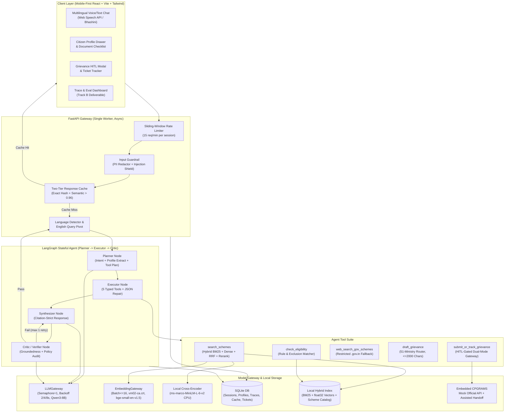
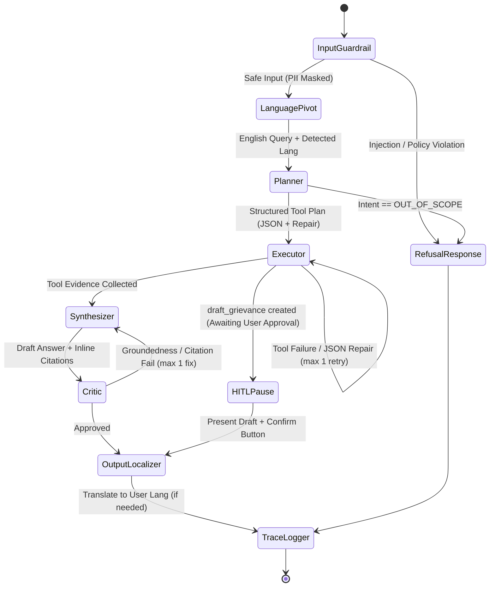
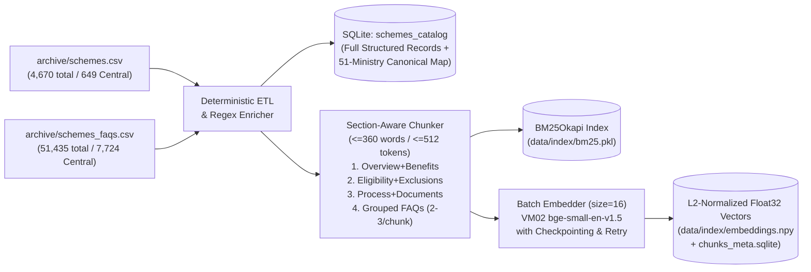
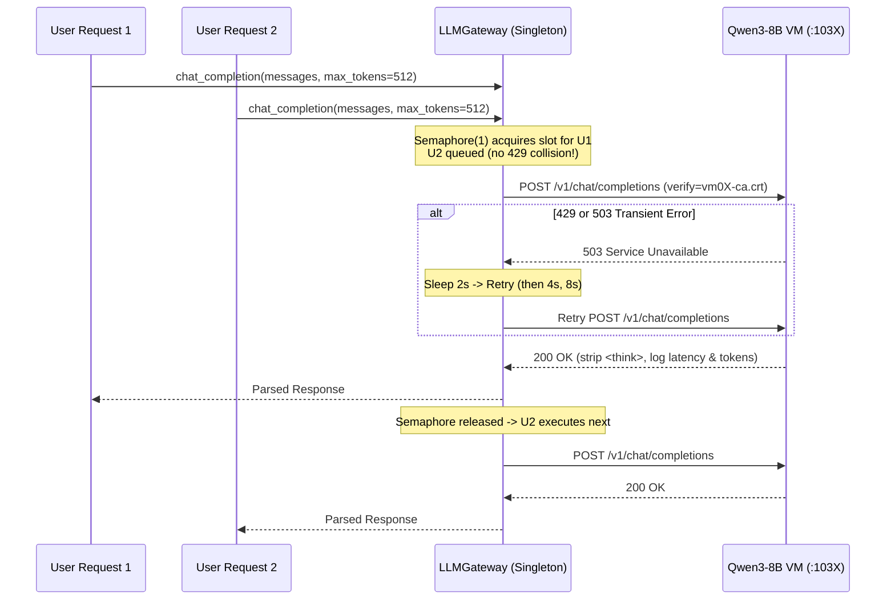

# Technical Architecture Document (TAD)
## **JanSahayak AI** — System Design, LangGraph Multi-Agent Flow & Repository Blueprint

| Metadata | Details |
| :--- | :--- |
| **Document Version** | 1.0 |
| **Architecture Pattern** | Layered Modular Monolith (FastAPI + LangGraph + Embedded Hybrid Index + React SPA) |
| **Design Philosophy** | Reliability through retrieval engineering, deterministic guardrails, strict concurrency control, and observable traces on an 8B hosted model |

---

## 1. High-Level System Architecture



---

## 2. LangGraph Multi-Agent Orchestration Flow

The core agent in `backend/agent/graph.py` implements Track B's mandatory **Planner → Executor → Critic** architecture with deterministic guardrails and strict loop bounds (max `2` executor steps, max `1` critic revision) to keep latency low under the 1-active-request VM cap.



### Key Architectural Guarantees
1. **Stateful Turn Memory (`AgentState`)**:
   - Persists `session_id`, `conversation_summary` (rolling compressed summary after 6 turns so history never exceeds 1,200 tokens!), `citizen_profile`, `active_scheme_slugs`, `pending_grievance_draft_id`, and `trace_events[]`.
2. **Token-Smart Execution on `Qwen/Qwen3-8B`**:
   - **Fast-Path Optimization**: For simple FAQ/scheme Q&A where the Planner emits a single `search_schemes` call, total LLM calls = **3 compact calls** (Planner `max_tokens=256` + Synthesizer `max_tokens=700` + Lightweight Critic `max_tokens=200`), OR **2 LLM calls** when deterministic citation verification passes and no conflicting eligibility math is detected!
   - **Qwen3 Thinking Control**: Planner, JSON Repair, Translation, and Critic calls explicitly disable `<think>` via `chat_template_kwargs={"enable_thinking": False}` (with regex `<think>` stripping fallback) so 100% of the `max_tokens` budget goes into clean JSON/answers.
3. **Human-in-the-Loop (HITL) Safety Boundary**:
   - The LLM can NEVER directly invoke `submit_or_track_grievance(action="submit")` on a fresh draft.
   - `draft_grievance` saves the draft in SQLite (`status='AWAITING_CONFIRMATION'`) and returns a structured payload to the UI, which renders an interactive **Grievance Review & Confirm Card**.
   - Only when the citizen clicks **Confirm & Submit** (calling `POST /api/grievances/{draft_id}/confirm`) or sends an explicit confirmation turn referencing that `draft_id` does the server set `user_confirmed=True` and submit to the CPGRAMS Gateway!

---

## 3. Data Ingestion & Hybrid Retrieval Pipeline



### Why SQLite + NumPy (`embeddings.npy`) + `rank-bm25` Over Heavy Vector DBs?
- **Zero Windows Build Fragility**: Avoids `hnswlib` / C++ compiler failures on Windows during overnight autonomous builds.
- **Blazing Speed & Tiny Footprint**: `5,500 chunks × 384 float32` = **8.4 MB in RAM**. Exact cosine similarity via `vectors @ query_vec` takes **`< 2 milliseconds`**, supports arbitrary SQLite metadata pre-filtering before matrix multiplication, and guarantees **100% exact recall** (no ANN approximation loss!).
- **Drop-In Extensibility**: Wrapped behind a clean `HybridRetriever` interface so Phase 3 can swap to Qdrant/pgvector for 1M+ state circulars without changing a single line of agent code.

---

## 4. LLM & Embedding Gateway Architecture (Concurrency & Resilience)



---

## 5. Dual-Mode Grievance Execution Architecture

To satisfy both **real autonomous tool execution in the Capstone Demo** AND **real-world citizen utility without waiting weeks for API Setu whitelisting**, `backend/services/grievance_provider.py` implements the Strategy Pattern:

```python
class GrievanceProvider(Protocol):
    async def submit_grievance(self, draft: GrievanceDraft) -> GrievanceReceipt: ...
    async def track_grievance(self, registration_number: str) -> GrievanceStatus: ...
```

1. **`SandboxCPGRAMSProvider` (Default `GRIEVANCE_MODE=sandbox`)**:
   - Sends real HTTP `POST` / `GET` requests to our embedded FastAPI `/mock-cpgrams/v1/grievances` service.
   - Enforces official CPGRAMS constraints (canonical 51-Ministry code, `<=2,000` chars, PII check), generates official-format IDs (`{MINISTRY_CODE}/E/2026/{SEQ:06d}`), stores tickets in SQLite `grievances` table, and always attaches an **Assisted Real-Portal Handoff Packet** (`pgportal.gov.in`).
   - Supports fault injection (`simulate_fault=503|timeout|bad_json`) for Week 3 reliability evaluation.
2. **`AssistedHandoffProvider` (`GRIEVANCE_MODE=assisted`)**:
   - Generates a validated local reference ID + ready-to-paste CPGRAMS complaint packet, required documents checklist, and deep link to `https://pgportal.gov.in/`.
3. **`APISetuCPGRAMSProvider` (`GRIEVANCE_MODE=apisetu`, Post-Capstone Plug-in)**:
   - Reads `APISETU_CLIENT_ID` & `APISETU_API_KEY` from `.env` for production UMANG/CPGRAMS submission once institutional approval is granted.

---

## 6. SQLite Database Schema (`data/jansahayak.db`)

| Table | Key Columns | Purpose |
| :--- | :--- | :--- |
| `schemes_catalog` | `slug (PK)`, `scheme_name`, `level`, `state`, `ministry`, `ministry_code`, `categories`, `benefit_type`, `dbt_scheme`, `age_min`, `age_max`, `income_cap_inr`, `social_categories_json`, `beneficiary_groups_json`, `eligibility`, `exclusions`, `benefits`, `application_process`, `documents_required`, `source_url`, `faq_count` | Fast deterministic eligibility checks, ministry lookup, and Scheme Explorer UI |
| `chunks_meta` | `chunk_id (PK)`, `vector_idx`, `scheme_slug`, `scheme_name`, `ministry`, `section`, `faq_numbers_json`, `text`, `token_count`, `source_url`, `metadata_json` | Maps vector row index & BM25 doc ID to chunk text + citations |
| `sessions` | `session_id (PK)`, `preferred_language`, `profile_json`, `summary`, `created_at`, `updated_at` | Persistent multi-turn state & Citizen Profile |
| `messages` | `id (PK)`, `session_id (FK)`, `role`, `content`, `citations_json`, `eligibility_json`, `grievance_json`, `trace_id`, `created_at` | Chat transcript persistence |
| `grievances` | `id (PK)`, `draft_id`, `registration_number`, `session_id`, `scheme_slug`, `ministry_code`, `ministry_name`, `subject`, `grievance_text`, `char_count`, `status`, `mode`, `user_confirmed`, `created_at`, `updated_at` | HITL draft storage + CPGRAMS Sandbox ticket ledger |
| `traces` | `trace_id (PK)`, `session_id`, `timestamp`, `user_query_masked`, `detected_lang`, `cache_hit`, `planner_json`, `retrieved_chunks_json`, `tool_calls_json`, `critic_json`, `guardrail_flags_json`, `prompt_tokens`, `completion_tokens`, `total_latency_ms`, `step_latencies_json`, `status` | Powers Track B **Trace Dashboard** & debugging |
| `response_cache` | `cache_key (PK)`, `query_en`, `lang`, `profile_hash`, `embedding_blob`, `response_json`, `created_at`, `expires_at` | Exact + Semantic Two-Tier Cache |
| `embedding_cache` | `text_hash (PK)`, `embedding_blob`, `created_at` | Avoids redundant VM02 embedding calls during dev & evals |

---

## 7. Target Repository Directory Structure (Blueprint for Antigravity IDE)

```text
Capstone_Project/
├── .env.example                       # Complete documented env template
├── .env                               # User-populated secrets (gitignored!)
├── .gitignore
├── README.md                          # Quickstart, architecture overview & demo guide
├── docker-compose.yml                 # One-command containerized deployment
├── Dockerfile.backend
├── Dockerfile.frontend
├── requirements.txt                   # Pinned Python 3.11 dependencies
├── start_local.ps1                    # Windows one-command launcher (backend + frontend)
│
├── archive/                           # [EXISTING] schemes.csv + schemes_faqs.csv
├── Capstone_Overview_resources/       # [EXISTING] API guides + vm02-ca.crt
├── certs/                             # User places vm0X-ca.crt here (gitignored!)
├── docs/                              # [CREATED] BRD, TRD, TAD, Overnight Runbook, Model Card
│   ├── 01_BRD_Product_Requirements.md
│   ├── 02_TRD_Technical_Requirements.md
│   ├── 03_Technical_Architecture.md
│   ├── 04_Overnight_Build_Runbook_and_Env_Checklist.md
│   └── 05_MODEL_CARD_AND_RESPONSIBLE_AI.md   # Generated in Milestone 7
│
├── data/                              # Generated local artifacts (gitignored except schema)
│   ├── jansahayak.db
│   └── index/
│       ├── embeddings.npy
│       ├── bm25.pkl
│       └── index_manifest.json
│
├── backend/
│   ├── main.py                        # FastAPI app, CORS, rate limiter, routers
│   ├── config.py                      # Pydantic Settings reading .env
│   ├── db/
│   │   ├── database.py                # SQLite connection & schema migrations
│   │   └── repositories.py            # CRUD for sessions, traces, grievances, cache
│   ├── gateway/
│   │   ├── llm_client.py              # Qwen3-8B client (Semaphore=1, backoff, <think> strip)
│   │   ├── embedding_client.py        # VM02 bge-small-en-v1.5 batch client + cache
│   │   └── translation_client.py      # Multilingual pivot (Qwen3 / Bhashini / Sarvam adapter)
│   ├── retrieval/
│   │   ├── etl.py                     # CSV loader + deterministic regex metadata enricher
│   │   ├── chunker.py                 # Section-aware & FAQ chunker (<=512 tokens)
│   │   ├── hybrid_retriever.py        # BM25 + Dense + RRF + Cross-Encoder Reranker
│   │   └── web_search.py              # Restricted .gov.in / myscheme.gov.in search tool
│   ├── guardrails/
│   │   ├── pii.py                     # Aadhaar, PAN, phone, IFSC regex detector & masker
│   │   ├── injection.py               # Prompt-injection & policy refusal classifier
│   │   └── cache.py                   # Two-tier Exact + Semantic response cache
│   ├── agent/
│   │   ├── state.py                   # LangGraph AgentState & Pydantic models
│   │   ├── tools.py                   # 5 typed Pydantic tools + JSON repair utility
│   │   ├── prompts.py                 # P1 (Zero-Shot), P2 (Few-Shot), P3 (Planner-Critic)
│   │   └── graph.py                   # LangGraph Planner -> Executor -> Synthesizer -> Critic
│   ├── services/
│   │   ├── grievance_provider.py      # Dual-mode Sandbox / Assisted / API Setu providers
│   │   └── mock_cpgrams_router.py     # Embedded FastAPI /mock-cpgrams/v1 API + fault injection
│   └── api/
│       ├── routes_chat.py             # /api/chat, /api/chat/stream, /api/sessions
│       ├── routes_schemes.py          # /api/schemes, /api/grievances
│       └── routes_observability.py    # /api/traces, /api/evals/summary, /api/health
│
├── scripts/
│   ├── verify_apis.py                 # Pre-flight smoke check for Qwen3-8B + VM02 Embeddings
│   └── ingest_data.py                 # Resumable ETL + chunking + embedding + BM25 builder
│
├── eval/
│   ├── golden_dataset.json            # 80 stratified gold queries
│   ├── redteam_dataset.json           # 20 adversarial prompt-injection & PII tests
│   ├── run_retrieval_eval.py          # R1/R2/R3/R4 retrieval ablation
│   ├── run_prompt_eval.py             # P1/P2/P3 prompting comparison
│   ├── run_agent_fault_eval.py        # Tool & JSON failure recovery benchmark
│   ├── run_redteam_eval.py            # Adversarial safety & failure taxonomy runner
│   ├── run_all_evals.py               # Master runner outputting report-ready MD/JSON
│   └── reports/                       # Generated benchmark outputs
│
├── tests/
│   ├── test_ingest.py
│   ├── test_guardrails.py
│   ├── test_retrieval.py
│   ├── test_agent_tools.py
│   └── test_api.py
│
└── frontend/                          # React + Vite + TypeScript + Tailwind CSS
    ├── package.json
    ├── vite.config.ts
    └── src/
        ├── App.tsx                    # Navigation: Citizen Copilot | Schemes | Grievances | Trace & Evals
        ├── components/
        │   ├── ChatWorkspace.tsx      # Multilingual voice/text chat + step progress + citations
        │   ├── ProfileDrawer.tsx      # Persistent Citizen Profile + DPDP Erase button
        │   ├── EligibilityCard.tsx    # Verdict badge + criteria + document checklist
        │   ├── GrievanceModal.tsx     # HITL Review, <=2000-char counter, Confirm & Handoff Packet
        │   ├── SchemeExplorer.tsx     # Searchable catalog of 649 Central schemes + FAQs
        │   ├── TraceDashboard.tsx     # Execution trace waterfall, retrieval scores, critic audit
        │   └── EvalDashboard.tsx      # Charts & tables from eval/reports/
        └── hooks/
            └── useVoiceIO.ts          # Browser Web Speech API (STT + TTS for Indic languages)
```

---

## 8. Technology Stack Decision Rationale (Defensible in Capstone Viva)

| Layer | Chosen Tech | Why This Choice Wins for Track B + GovTech Productization |
| :--- | :--- | :--- |
| **Agent Framework** | **LangGraph** (`langgraph`) | Explicitly referenced in IIT KGP Module 4.2 syllabus; gives deterministic state transitions for Planner → Executor → Critic, native HITL pause points, and structured trace capture—unlike opaque autonomous loops that fail on 8B models. |
| **Backend API** | **FastAPI + Uvicorn (1 worker)** | Covered in Module 5.2; async SSE streaming, strict Pydantic v2 validation, and single-worker process model pairs naturally with `asyncio.Semaphore(1)` for Track B's 1-active-request VM rule. |
| **Hybrid Retrieval** | **`rank-bm25` + `bge-small-en-v1.5` (NumPy/SQLite) + `cross-encoder/ms-marco-MiniLM-L-6-v2`** | Zero Windows compilation hazards, `<150ms` total hybrid+rerank latency on CPU, exact cosine similarity, transparent BM25/Dense/RRF/Rerank score logging for ablation studies. |
| **Frontend UI** | **React 18 + Vite + TypeScript + Tailwind CSS** | Delivers a credible, mobile-first Digital India citizen UX (voice mic, profile sidebar, HITL grievance modal, clickable citations) PLUS an integrated **Trace & Eval Dashboard** for evaluators and funders—far stronger than a basic Streamlit script. |
| **Database** | **SQLite (WAL mode)** | Zero external daemon setup for overnight autonomous builds or evaluator reproduction; easily migrates to PostgreSQL in Phase 3. |
| **Multilingual & Voice** | **English-Pivot Query Translation + Browser Web Speech API + Pluggable Bhashini/Sarvam Adapter** | Works 100% out-of-the-box with ZERO extra paid keys while cleanly solving `bge-small-en-v1.5`'s English-only limitation and supporting instant enterprise Bhashini upgrade. |
